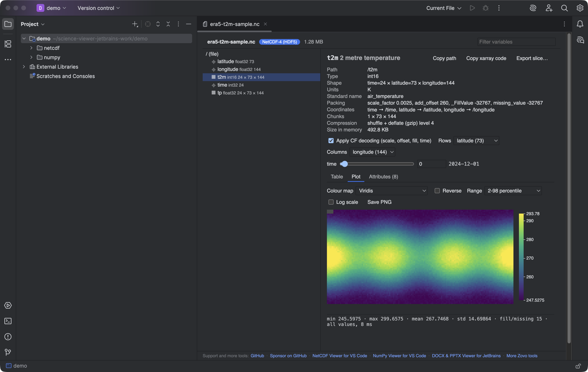

# NetCDF, HDF5 & NumPy Viewer for JetBrains IDEs

Open NetCDF (.nc, .nc4, .cdf), HDF5 (.h5, .hdf5, .he5) and NumPy (.npy, .npz) files in a read-only viewer inside PyCharm, IntelliJ IDEA, DataSpell, CLion and the other JetBrains IDEs (2025.2 and later).



## What it shows

NetCDF and HDF5:
- the tree of groups, variables and dimensions, with shape, type, chunks and compression
- attributes and CF metadata: units, scale and offset, fill values, and time axes decoded to dates
- a heatmap of any 2D slice, with a slider for each other dimension, colour maps, range and log scale
- a line plot for 1D variables and a time series for the point you click
- stats, a paged value table, and CSV export of the current slice

NumPy:
- the array list of an .npz with shape, dtype and size
- stats from all values, and a value table with paging
- a heatmap for 2D arrays and an image view for H x W x 3 or 4 arrays
- save an array or one slice as .npy or CSV

Everything is read-only and offline. The plugin makes no network calls.

## Install

Settings | Plugins | Marketplace, search for "NetCDF". Or download the zip from the Marketplace page and use "Install Plugin from Disk".

## How it works

The editor tab is a JCEF browser. Its page comes from a private origin, `http://zovo-science/`, which the plugin serves itself (`zovo.jcefshell.ShellScheme`). Nothing goes over the network.

- The file is never sent whole. The page and its Web Worker ask for byte ranges: `GET /t/<token>/file?offset=&length=`. A range past the end of the file gets HTTP 416. The token is random per open tab, and it is removed when the tab closes.
- HDF5 and NetCDF-4 are read by [h5wasm](https://github.com/usnistgov/h5wasm) in a Web Worker. The file is mounted in its virtual file system as a lazy node that loads 1 MB chunks on demand, so a 2 GB file opens after reading only its metadata.
- NetCDF-3 is read by [netcdfjs](https://github.com/cheminfo/netcdfjs) (header) plus offset reads (values).
- .npy and .npz are read by the core of the Zovo NumPy viewer, also by byte range.
- Saving (CSV, PNG, .npy) and copying go back to the IDE through `POST /t/<token>/save` and `/copy`. The IDE shows its own save dialog and never writes over the file you are viewing.
- Without JCEF (remote development, some Linux setups) the tab shows the header of NetCDF-3 and .npy files, parsed in Kotlin, and an "Open in Default App" button.

## Build

The browser bundles are committed in `src/main/resources/web`, so the Gradle build needs no Node.

```
cd web && npm ci && npm run bundle && npm test   # rebuild the bundles, run 95 JS tests
cd .. && ./gradlew test verifyPlugin buildPlugin  # JDK 21+
./gradlew runIde                                  # sandbox IDE
```

`web/src/netcdf` and `web/src/tensor` are copies of the cores and webviews of [netcdf-viewer-vscode](https://github.com/theluckystrike/netcdf-viewer-vscode) 0.3.0 and [tensor-viewer-vscode](https://github.com/theluckystrike/tensor-viewer-vscode) 0.3.1. Only the host side is new: `shim.js` in each folder replaces the VS Code extension host, and `web/src/shared` holds the range reader, the lazy file and the `fs` stand-in for the worker.

## How to reuse the JCEF shell

`zovo.jcefshell` has no science code in it:

1. `Routes.register(ViewerEntry(token, file, name, kind, ...))` makes a file readable under `/t/<token>/`.
2. `ShellEditor` (a `FileEditor`) registers the entry, opens `http://zovo-science/t/<token>/view.html` in a `JBCefBrowser`, reloads on theme change and unregisters on dispose.
3. `view.html` loads `/static/<kind>.js` and `/static/<kind>.css`. Put your bundles in `src/main/resources/web`.
4. `ShellTheme` turns the IDE colours into `--vscode-*` CSS variables, so VS Code webview code looks right without changes.

## Support and more tools

- Source and issues: https://github.com/theluckystrike/science-data-viewer-jetbrains
- Sponsor: https://github.com/sponsors/theluckystrike
- NetCDF Viewer for VS Code: https://marketplace.visualstudio.com/items?itemName=zovo.hdf5-netcdf-explorer
- NumPy Viewer for VS Code: https://marketplace.visualstudio.com/items?itemName=zovo.tensor-viewer
- DOCX & PPTX Viewer for JetBrains: https://github.com/theluckystrike/office-viewer-jetbrains
- All Zovo tools: https://github.com/theluckystrike

## License

MIT. Bundled libraries and their licenses are listed in THIRD-PARTY-NOTICES.txt (h5wasm and the HDF5 library, netcdfjs, fflate and others).
